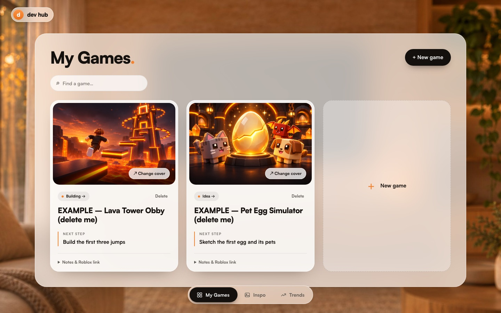

# Dev Hub

A free little app for making Roblox games. It runs on your own computer and keeps three things in one window:

- **My Games**: every game you're making, with a cover, its stage (Idea → Building → Testing → Live), your next step and notes. Paste a published game's link to see its live players, visits and like %.
- **Inspo**: paste screenshots and links of anything you love. Tag them and link them to a game.
- **Trends**: what's Rising, Trending and Top earning on Roblox right now. Save any game to your inspo in one click.



Your games, notes and images stay in the `data` folder on your computer. No account, nothing uploaded. The app only talks to Roblox (for public game details and trends) and Fontshare (for its font).

## Run it

You need **Python 3.8+** (free, no other installs).

1. **[Download Dev Hub](https://github.com/patrickmata68-bot/dev-hub/releases/latest/download/dev-hub.zip)** and unzip it somewhere like Documents.
2. **Mac:** double-click `Start Dev Hub.command`. If macOS blocks it: right-click → Open → Open. If it says you need Python, install it from [python.org](https://www.python.org/downloads/) and double-click again.
   **Windows:** install Python from [python.org](https://www.python.org/downloads/) (tick **"Add python.exe to PATH"**), then double-click `Start Dev Hub.bat`.
3. Your browser opens Dev Hub. Keep the black window open while you use it. Close it to stop.

The two games it starts with are fake examples. Delete them.

Keys: **1 / 2 / 3** switch pages, **/** jumps to search, paste anywhere on Inspo to add what you copied.

## Make it yours

Open the folder in Claude Code or Codex and ask:

```
Add [feature] to Dev Hub. Read README.md first. Keep it standard-library Python and plain HTML/CSS/JS.
```

## Build your own from scratch

Want to build your own version instead? Paste this into Claude Code or Codex in an empty folder:

```
Build me a local web app called Dev Hub for my Roblox game dev. Python 3 standard library only (http.server), plain HTML/CSS/JS, no installs.
Run on 127.0.0.1, open the browser on start, save everything to data/hub.json on my computer.
Three pages:
1. Games: a card per game with a cover image (paste or drop), stage Idea/Building/Testing/Live, a next-step line, notes,
   and an optional Roblox game link that shows live playing, visits and like % (games.roblox.com + apis.roblox.com/universes).
2. Inspo: a masonry board. Paste images or links; Roblox links become game cards with icon and name. Tags, filter by tag.
3. Trends: Roblox's explore lists up-and-coming, top-trending and top-earning
   (apis.roblox.com/explore-api/v1/get-sort-content?sortId=...&sessionId=x&device=all&country=all),
   with icons (thumbnails.roblox.com) and player counts, cached 20 minutes, with a "save to inspo" button.
   The browser can't call Roblox directly (CORS), so the Python server fetches it.
Design: dark, premium, one accent colour, big images, works on a phone. Add a Mac .command and a Windows .bat to start it.
Write the plan first, then build it, then test every page and show me screenshots.
```

## For developers

- Start: `python3 server.py` (`--no-browser` to skip opening a tab). Binds to 127.0.0.1, ports 8765–8775.
- Tests (offline): `python3 test_smoke.py`
- Data: `data/hub.json`, images in `data/uploads/`. Back up the `data` folder.
- Font: [Satoshi](https://www.fontshare.com/fonts/satoshi) loaded from Fontshare; falls back to your system font offline.

Made by [@momentumcash](https://www.tiktok.com/@momentumcash). Not affiliated with Roblox.
